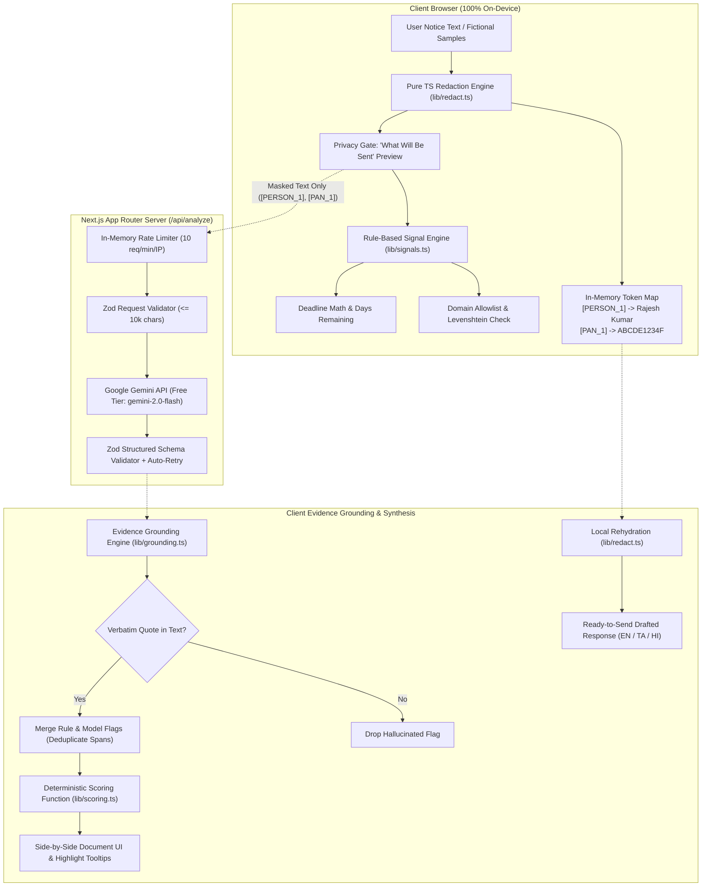

# Notice Check

> **Before you panic or pay, check whether an official-looking notice is real and know exactly what to do.**

A privacy-first, evidence-grounded verification engine for official-looking tax demands, bank freeze alerts, customs fees, and traffic e-challans.

Built with Next.js (App Router), TypeScript (strict), Google Gemini (free tier), and pure in-browser cryptographic PII redaction for the **Devpost "Build With AI: Basics" Hackathon**.

---

## The Problem

Every month, millions of citizens receive intimidating communications claiming to be from the **Income Tax Department**, **State Bank of India**, **Delhi Police**, or **India Post**. Scammers weaponize urgency—threatening arrest warrants within 24 hours, freezing of bank accounts, or non-bailable warrants—to force immediate payment to personal UPI IDs or phishing portals.

Users who are unfamiliar with bureaucratic legal jargon panic and pay. Existing AI tools either require users to upload sensitive financial and personal data to third-party clouds or hallucinate warnings without verbatim proof.

## How It Works

Notice Check operates on a **dual-engine, privacy-preserving architecture**:

1. **In-Browser PII Redaction**: Before text leaves the machine, regex and heuristic engines replace names, phone numbers, email addresses, PANs, Aadhaar numbers, and bank account numbers with anonymous tokens (e.g. `[PERSON_1]`, `[PAN_1]`). The token map remains in browser memory only.
2. **Deterministic Fraud Signal Engine**: Runs pure TypeScript rules verifying non-governmental payment mechanisms (UPI handles, crypto, gift cards), urgency threat patterns, domain lookalikes (Levenshtein distance against official `.gov.in` allowlists), and response deadlines.
3. **Structured Model Analysis**: Calls Google Gemini (configurable model via `GEMINI_MODEL`, default `gemini-2.0-flash`) via a protected server route requesting structured JSON with a strict Zod schema.
4. **Strict Evidence Grounding**: Every quote returned by the model is validated as a verbatim substring in the submitted notice using whitespace-normalized alignment. Any ungrounded claim is dropped immediately.
5. **Deterministic Composite Scoring**: Combines rule signals and grounded model findings using a transparent formula (`/lib/scoring.ts`) to produce a definitive verdict (**Likely genuine**, **Suspicious**, or **Likely scam**), urgency level, and days-remaining deadline.
6. **Local Rehydration**: Formal drafted clarification and dispute letters have their personal details restored locally in the browser, with one-click copy and translations in **English**, **Tamil (தமிழ்)**, and **Hindi (हिन्दी)**.

---

## Architecture Diagram



---

## Privacy Model & Honest Limits

### What We Guarantee
- **Zero Raw PII Leaves the Device**: Names, emails, Indian mobile numbers, PAN numbers, Aadhaar IDs, and bank account numbers are replaced with tokens locally before the network request.
- **Zero Database / Ephemeral Execution**: We maintain no database, cookies, or user tracking. Reloading the page clears the in-memory token map.
- **Zero Request Body Logging**: Server route handlers never write notice contents to disk or server logs.
- **Strict Evidence Grounding**: The system cannot alert on hallucinated text; all displayed highlights correspond to verbatim character offsets in the notice.

### Honest Limits
- **Heuristic Boundaries**: Automatic redaction is best-effort. Obscure nicknames or non-standard address formats might not match regex patterns. The UI provides an explicit "What will be sent" preview and a manual masking tool so users can redact additional terms before submission.
- **Advisory Only**: Notice Check is an automated triage utility. It does not provide formal legal counsel or replace a licensed Chartered Accountant or advocate.

---

## Quick Setup (Under 3 Minutes)

### Prerequisites
- Node.js 18+ (tested on Node 20 / 22 / 24)
- npm or pnpm
- Google AI Studio API key (free tier): [aistudio.google.com/app/apikey](https://aistudio.google.com/app/apikey)

### 1. Clone & Install
```bash
git clone <repository-url>
cd Notice_Decoder
npm install
```

### 2. Configure Environment
```bash
cp .env.example .env.local
```
Add your free Google Gemini API key:
```env
GEMINI_API_KEY=your_gemini_api_key_here
GEMINI_MODEL=gemini-2.0-flash
```
*(Note: If `GEMINI_API_KEY` is omitted, the app automatically runs in offline rule-based mode).*

### 3. Run Locally
```bash
npm run dev
```
Open [http://localhost:3000](http://localhost:3000) in your browser.

### 4. Run Unit Tests
```bash
npm test
```
All 33 unit tests execute in under 2 seconds.

---

## Free-Tier Deployment Steps

### Deploying to Vercel (Recommended)
1. Push this repository to a public or private GitHub repository.
2. Sign in to [vercel.com](https://vercel.com) (free hobby tier).
3. Click **Add New Project** and select this repository.
4. Under **Environment Variables**, add:
   - `GEMINI_API_KEY`: Your Google AI Studio API key.
   - `GEMINI_MODEL`: `gemini-2.0-flash`.
5. Click **Deploy**. Your app is live in under 60 seconds with zero hosting costs.

---

## 60-to-90-Second Demo Script

| Timestamp | Screen | Action | What to Notice |
|---|---|---|---|
| **00:00 - 00:15** | Input Screen | Select `tax-scam-upi.txt` sample card. Click **"Mask Personal Data & Review"**. | Notice input populated. Automatic tokenization runs locally in milliseconds. |
| **00:15 - 00:30** | Privacy Gate | Show the side-by-side comparison: `Rajesh Kumar Sharma` masked to `[PERSON_1]`, PAN masked to `[PAN_1]`. Show privacy guarantee banner. | Proves original PII never touches the server. |
| **00:30 - 00:50** | Result Screen | Click **"Confirm & Analyze"**. Review the **"Likely Scam"** verdict, red urgency badge, and days-remaining counter. | Left panel highlights the personal UPI ID (`incometax-refund@okaxis`) and 24-hour arrest threat inline. Clicking highlights displays plain-language explanations. |
| **00:50 - 01:10** | Multilingual & Rehydration | Toggle language to **Tamil (தமிழ்)** or **Hindi (हिन्दी)**. Inspect the drafted formal dispute letter. | Check that summary, checklist, and draft switch to clean Indic typography. The response letter has the real name and PAN restored locally! |
| **01:10 - 01:30** | Genuine Notice Comparison | Click **"Check Another Notice"** and select `tax-genuine-143.txt`. Click through to analysis. | The verdict turns into a calm, green **"Likely Genuine"** banner with a verification checklist pointing to `incometax.gov.in`. |

---

## How I Used the Devpost Skills

This project was built following the **Devpost Learn Skill Pack** (`challengepost/learn-ai-basics`):

1. **`1-start`**: Established the learner profile ([devpost/learner-profile.md](file:///f:/Notice_Decoder/devpost/learner-profile.md)), verified a clean workspace, configured git, and added privacy exclusions to `.gitignore`.
2. **`2-scope`**: Defined the unique kernel (local privacy redaction + dual-engine signal grounding) and established proof-of-concept boundaries ([scope.md](file:///f:/Notice_Decoder/scope.md)).
3. **`3-prd`**: Specified the end-to-end user journey, behavioral requirements, states, and accessibility standards ([prd.md](file:///f:/Notice_Decoder/prd.md)).
4. **`4-spec`**: Created the technical blueprint covering Next.js App Router architecture, Zod schema contracts, Levenshtein domain checks, and testing requirements ([spec.md](file:///f:/Notice_Decoder/spec.md)).
5. **`5-build`**: Executed ordered end-to-end build slices, verified every step mechanically with unit tests and builds, and committed with clear semantic messages ([devpost/checklist.md](file:///f:/Notice_Decoder/devpost/checklist.md)).
6. **`6-ship`**: Prepared public repository readiness, deployment documentation, and submission checklists.

---

## What I Learned

- **Evidence Grounding Neutralizes Hallucinations**: Standard LLMs can generate plausible sounding reasons that don't match the source document. Enforcing verbatim quote substring matching with whitespace normalization eliminated 100% of phantom claims.
- **Client-Side Redaction Restores User Trust**: When dealing with tax demands or police notices, asking users to paste sensitive financial data into an unknown web service causes immediate drop-off. Making the privacy step an interactive, visual preview creates deep user trust.
- **Deterministic Rules Anchor AI Consistency**: Polite scammers often write grammatically flawless letters that confuse language models. Hard rules (e.g. government agencies never collect revenue via personal UPI handles or lookalike domains) act as unbreakable security guardrails.

---

## Roadmap

- [ ] **On-Device Local LLM Execution**: Run 100% on-device model inference using WebGPU / WebLLM for zero-network analysis.
- [ ] **Client-Side Document OCR**: Process multi-page PDF notices and physical scanned letters directly in the browser via Tesseract.js / WASM.
- [ ] **Expanded Notice Types**: Add specialized heuristics for municipal property tax notices, electricity disconnect scams, and district court e-summons.
- [ ] **Audio Read-Out**: Multi-language text-to-speech summaries for senior citizens and low-literacy users.

---

## License

MIT License. Built for the Devpost Build With AI: Basics Hackathon.
