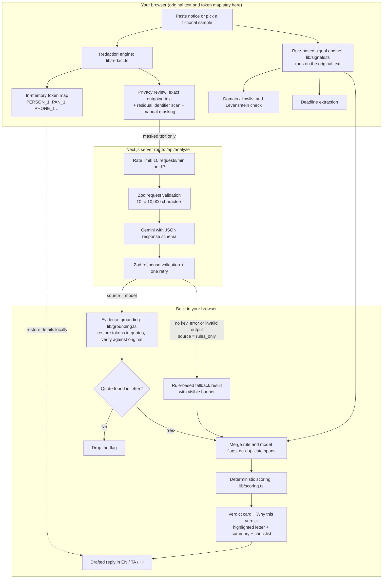
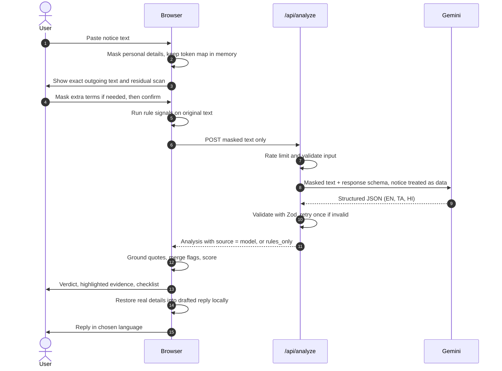
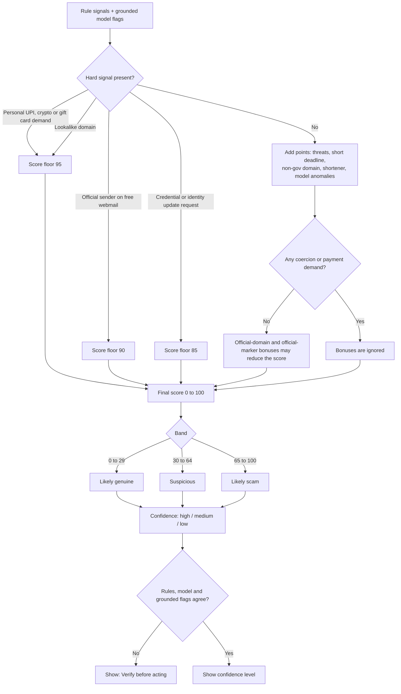

# Notice Check

**Before you panic or pay, check whether an official-looking notice is real, and know exactly what to do.**

Notice Check is a privacy-first verification tool for the tax demands, bank freeze alerts, customs fees and traffic e-challans that people in India receive every day. Paste a notice and your browser masks your personal details first. You then get a verdict backed by highlighted evidence from the letter, a plain-language summary, a deadline counter and a next-steps checklist in English, Tamil or Hindi.

Built for the **Devpost "Build With AI: Basics"** hackathon with the Devpost Learn Skill Pack.

> Guidance only. Notice Check is an automated triage aid, not legal or financial advice. Always confirm through the official website or helpline that you look up yourself.

**Contents:** [Problem](#the-problem) · [What makes it different](#what-makes-it-different) · [How it works](#how-it-works) · [Flow diagrams](#flow-diagrams) · [Features](#features) · [Detection signals](#detection-signals) · [Scoring](#how-the-verdict-is-scored) · [Privacy](#privacy-model-and-honest-limits) · [Setup](#quick-setup) · [API](#api) · [Testing](#testing) · [Deployment](#deployment) · [Demo script](#demo-script-60-90-seconds) · [Devpost skills](#how-i-used-the-devpost-skills) · [Limitations](#known-limitations) · [Roadmap](#roadmap)

---

## The Problem

Every day, people receive letters and messages that claim to come from the Income Tax Department, a bank, India Post, customs or the traffic police. Scammers copy this format on purpose. They threaten arrest warrants, account freezes or seizure of a parcel, set a deadline of 24 hours, and ask for payment to a personal UPI ID or a lookalike website.

Two things go wrong:

- **Fake notices get obeyed.** Frightened people pay before they verify.
- **Real notices get ignored.** Legal and bureaucratic wording is hard to read, especially in a second language, so deadlines are missed.

Existing options fall short. A general chatbot can explain a letter, but you have to paste raw personal details into it, you get a block of text, and nothing shows *why* it thinks the letter is fake. Scam checkers focus on links and phone calls, not the official-looking letter with a deadline and a plausible demand.

Notice Check is built around one question: **is this notice real, and what should I do right now?**

---

## What makes it different

| | General chatbot | Notice Check |
|---|---|---|
| Personal data | You paste everything | Names, phone numbers, PAN, account numbers and more are masked in your browser first; you review exactly what is sent |
| Verdict | Free-text opinion | Likely genuine, Suspicious or Likely scam, with a confidence level and a "Why this verdict" breakdown |
| Evidence | None | The exact lines in your letter are highlighted and explained. A model claim without a verbatim quote from the letter is discarded |
| Who decides | The model alone | Deterministic rules and the model together. Hard signals (personal UPI demand, lookalike domain, credential request) set a score floor the model cannot lower |
| Failure handling | Looks confident either way | If the AI is unavailable, the app says so and falls back to rule-based results |
| Languages | Whatever you ask for | English, Tamil and Hindi in one request, with instant switching |
| Output | Paragraphs | Verdict card, urgency, days remaining, checklist with official-channel steps, and a drafted reply with your details restored locally |

**The stand-out ideas:**

1. **Reversible local redaction.** Personal details are swapped for placeholders like `[PERSON_1]` and `[PAN_1]` in the browser. Only the placeholders go to the server. The token map stays in browser memory and is used to restore your details in the drafted reply.
2. **Evidence grounding.** Every flag the model returns must include a verbatim quote. The quote is checked against your original letter, and flags that cannot be matched are dropped before anything is shown.
3. **Hybrid detection with a documented score.** A pure-TypeScript rule engine runs alongside the model. A transparent scoring function in `lib/scoring.ts` combines both, and the breakdown is shown to the user.
4. **Honest by design.** A privacy review step with a residual-data scan, a visible "rule-based only" banner, qualitative confidence instead of a made-up percentage, and a "verify before acting" warning when signals disagree.

---

## How it works

1. **Paste or pick a sample.** Up to 10,000 characters of text, or one of six built-in fictional notices (four scams, two genuine).
2. **Mask locally.** The browser replaces recognised personal details with stable placeholders. The same value always gets the same placeholder.
3. **Privacy review.** A side-by-side view shows the original and the exact text that will be sent. A scan checks the outgoing text for identifier patterns that were missed. You can mask extra words by hand. The confirm button stays disabled while the scan finds supported patterns.
4. **Rule-based signals.** On your original text, in the browser: payment channels, threat language, credential requests, short deadlines, personal-account transfer demands, link and domain checks, sender mismatches and deadline extraction.
5. **Model analysis.** The masked text goes to a server route that calls Gemini with a response schema. The reply is validated with Zod and retried once if invalid. The notice is treated as untrusted data, and any instructions inside it are ignored.
6. **Evidence grounding.** Placeholders in model quotes are restored locally, each quote is matched against your original letter (whitespace-normalised), and ungrounded flags are dropped. Rule and model flags are merged and overlapping highlights are de-duplicated.
7. **Scoring.** A deterministic function turns the rule signals and grounded flags into a verdict, urgency level and confidence level, with a point-by-point breakdown.
8. **Result.** The letter with highlighted evidence on one side. The verdict, summary, checklist and reply on the other.

---

## Flow diagrams

### System architecture



### One analysis, step by step



### How the verdict is decided



---

## Features

### Privacy
- Browser-side masking of names after salutations, phone numbers, emails, PAN, Aadhaar-style numbers, IFSC codes, labelled account numbers, PIN codes and address lines
- Stable placeholders (the same value always maps to the same token) and an in-memory token map that is never sent anywhere
- Privacy review screen with side-by-side and masked-only views
- Residual identifier scan on the outgoing text that reports categories and counts only, never the values
- Manual masking of any extra word or number
- Confirm button disabled while the scan detects supported patterns
- No database, no accounts, no analytics, and no logging of notice content by the application

### Analysis
- Rule-based signal engine in pure TypeScript with unit tests
- Gemini analysis with a response schema, Zod validation and one automatic retry
- Prompt-injection guard: the notice is wrapped as data and the model is told to ignore instructions inside it
- Evidence grounding with token rehydration, whitespace-normalised matching and de-duplication of overlapping highlights
- Deterministic scoring with hard floors and a visible breakdown
- Qualitative confidence (high, medium, low) and a "verify before acting" warning when signals disagree
- Graceful fallback to rule-based results, clearly labelled

### Result screen
- Verdict card: Likely genuine, Suspicious or Likely scam
- Urgency badge (high, medium, standard) and a days-remaining counter or "Deadline Expired"
- The original letter with highlighted evidence, coloured by severity (critical, warning, info, positive); click a highlight for a plain-language explanation
- "Why this verdict": each scoring factor with its points
- Plain-language summary: what this is, what it demands, what happens if ignored
- Next-steps checklist you can tick off, with an "Official Channel" badge on verification steps
- Drafted reply with your real details restored locally and a one-click copy button

### Languages and typography
- English, Tamil (தமிழ்) and Hindi (हिन्दी), with instant switching and no second request
- Self-hosted Inter, Noto Serif, Noto Sans Tamil and Noto Sans Devanagari, with licences included in `public/fonts`
- Rule explanations, checklist and fallback text are translated in the app itself

### Engineering
- Next.js App Router, TypeScript in strict mode, Tailwind CSS
- Per-IP rate limiting on the API route and input length limits
- Content Security Policy and other security headers
- 49 unit tests across eight files, plus lint, type-check and production build

---

## Detection signals

| Signal | What it looks for | Effect |
|---|---|---|
| Personal payment demand | Personal UPI handles (for example `@okaxis`, `@ybl`, `@paytm`), cryptocurrency wallet addresses, gift-card or voucher codes | Score floor 95 |
| Lookalike domain | A domain within a small edit distance of an official domain (Levenshtein check) | Score floor 95 |
| Free-webmail sender | An official agency claimed, but the sender uses a consumer email address | Score floor 90 |
| Credential request | OTP, PIN, CVV, password or identity update requested through a notice link | Score floor 85 |
| Arrest or warrant threat | Warrant, arrest and similar intimidation wording | +30 |
| Account freeze threat | Account freeze or debit-freeze wording | +25 |
| Extreme deadline | Under 24 hours (and, as a signal, 72 hours or less) | +15 |
| Non-government domain | A government notice that links to a non-government domain | +35 |
| URL shortener | bit.ly, tinyurl.com, t.co, is.gd, cutt.ly and others | +15 |
| Personal-account transfer | A demand to transfer to a bank or personal account instead of an official payment channel | Counted as a payment demand |
| Model anomalies | Procedural inconsistencies found by the model and confirmed by a grounded quote | +10 |
| Official domain match | A link on the verified allowlist | -40, only when no coercion or payment demand is present |
| Official markers | Valid verification markers such as a DIN | -20, only when no coercion or payment demand is present |

**Official domain allowlist** (used for exact-match and lookalike checks): incometax.gov.in, eportal.incometax.gov.in, incometaxindia.gov.in, tin-nsdl.com, pan.utiitsl.com, parivahan.gov.in, echallan.parivahan.gov.in, sarathi.parivahan.gov.in, indiapost.gov.in, icegate.gov.in, cbic.gov.in, cybercrime.gov.in, india.gov.in, rbi.org.in, sbi.co.in, onlinesbi.sbi, hdfcbank.com, icicibank.com, axisbank.com, pnbindia.in and bankofbaroda.in. This is a starter list, not a complete registry.

---

## How the verdict is scored

`lib/scoring.ts` is deterministic and documented. The model is one input, not the judge.

| Score | Verdict | Urgency colour |
|---|---|---|
| 0 to 29 | Likely genuine | Green (low) |
| 30 to 64 | Suspicious | Amber (medium) |
| 65 to 100 | Likely scam | Red (high) |

- **Hard floors** raise the score regardless of what the model says. For example, a personal UPI demand always scores at least 95.
- **Positive markers cannot rescue a letter.** A real government link or a valid-looking reference number reduces the score only when there is no coercion, payment demand, lookalike domain or sender mismatch. Scammers often include a real link as decoration.
- **Confidence is qualitative.** High, medium or low reflects agreement between rule signals, the model's verdict and grounded flags. If they disagree, the result says "Verify before acting".
- **Everything is explained.** The "Why this verdict" panel lists each factor and its points.

---

## Privacy model and honest limits

**What the app does**
- Masks common identifiers in your browser before anything is sent.
- Shows the exact outgoing text and scans it for identifier patterns that were missed.
- Keeps the original text and the token map in browser memory only; they are cleared when you reset or reload.
- Does not intentionally store notice content in a database or log request bodies. Hosting platforms may keep their own operational logs.
- Serves fonts from the app itself, with a Content Security Policy that restricts scripts, connections, fonts, images, frames and form targets to the app's own origin. Next.js currently needs `unsafe-inline` for scripts, and development mode additionally allows eval and local WebSocket connections.
- Sets further security headers: HSTS in production, `X-Frame-Options: DENY`, `X-Content-Type-Options: nosniff`, `Cross-Origin-Opener-Policy`, `Cross-Origin-Resource-Policy`, `Referrer-Policy` and a restrictive `Permissions-Policy`.

**What it does not do**
- **Masking is best-effort.** Regex and context rules can miss names, addresses and unusual formats. Review the outgoing text and mask anything else by hand.
- **A clean scan is not a guarantee.** The scan only covers common machine-readable patterns.
- **Masked text is sent to a third party.** When AI analysis is on, the masked text goes to Google's Gemini API. Do not submit anything you are not comfortable sharing, even after masking.
- **It is not legal or financial advice.**

---

## Quick setup

**Prerequisites:** Node.js 18 or newer, npm, and a free Google AI Studio API key from [aistudio.google.com/app/apikey](https://aistudio.google.com/app/apikey).

```bash
git clone <repository-url>
cd notice-check
npm install
cp .env.example .env.local
```

Edit `.env.local`:

```env
GEMINI_API_KEY=your_key_here
GEMINI_MODEL=<a model currently available on the Gemini API free tier>
```

> **Model names change.** Google retires Gemini models on a schedule. Set `GEMINI_MODEL` explicitly to a model that Google's current Gemini API docs list as available on the free tier and that supports JSON response schemas. If the configured model is unavailable, the app drops to rule-based mode and shows a banner instead of an AI analysis.

```bash
npm run dev
```

Open [http://localhost:3000](http://localhost:3000).

**Without an API key** the app still runs in rule-based mode. You get the verdict, highlighted evidence, score breakdown and checklist, but not the AI summary or drafted reply.

### Environment variables

| Variable | Required | Purpose |
|---|---|---|
| `GEMINI_API_KEY` | No (needed for AI analysis) | Google AI Studio key, read only on the server |
| `GEMINI_MODEL` | Recommended | Gemini model name, read only on the server |

---

## API

### `POST /api/analyze`

Request:

```json
{ "maskedText": "Dear [PERSON_1], your PAN [PAN_1] ..." }
```

`maskedText` must be 10 to 10,000 characters.

Response (abridged):

```json
{
  "source": "model",
  "noticeType": "Income Tax Demand",
  "verdict": "likely_scam",
  "confidenceScore": 95,
  "urgencyLevel": "high",
  "oneSentenceReason": { "en": "...", "ta": "...", "hi": "..." },
  "summary": { "whatThisIs": {}, "whatItDemands": {}, "consequenceIfIgnored": {} },
  "flags": [{ "quote": "...", "category": "threat_or_coercion", "severity": "critical", "explanation": {} }],
  "checklist": [{ "step": 1, "action": {}, "isOfficialChannel": true }],
  "draftReply": { "en": "...", "ta": "...", "hi": "..." }
}
```

- `source` is `"model"` or `"rules_only"`. In rules-only mode the UI shows a banner and hides model-written summary and reply text.
- The model's own `verdict` and `confidenceScore` are inputs to the client-side scoring function, not the final answer shown to the user.
- Every localized field contains `en`, `ta` and `hi`.
- Errors: `400` for invalid input, `429` with `Retry-After` when rate limited (10 requests per minute per IP, in memory), `500` for unexpected failures.

### `GET /api/health`

Returns service status and whether an API key is configured.

---

## Testing

```bash
npm test               # 49 unit tests (Vitest)
npx tsc --noEmit       # type-check
npm run lint           # ESLint
npm run build          # production build
```

| Test file | Tests | Covers |
|---|---|---|
| `redact.test.ts` | 9 | Masking patterns, stable tokens, rehydration |
| `privacy-scan.test.ts` | 4 | Residual identifier detection on outgoing text |
| `signals.test.ts` | 10 | Payment, threat, credential, domain and sender rules |
| `grounding.test.ts` | 6 | Quote matching, token restoration, dropped flags, de-duplication |
| `scoring.test.ts` | 4 | Floors, bonuses, confidence level |
| `deadline.test.ts` | 4 | Deadline extraction and days remaining |
| `samples.test.ts` | 9 | All six samples in rules-only mode, decoy letter, security-warning letter, prompt-injection letter |
| `api.test.ts` | 3 | Request schema and rate limiter |

---

## Sample notices

All six samples are fictional and carry a "Sample letter - fictional" label. Use only these in demos and screenshots.

| Sample | Type | What to notice |
|---|---|---|
| Income Tax Demand Notice | Scam | Arrest threat, personal UPI ID, lookalike domain |
| Income Tax Sec 143(1) Intimation | Genuine | Valid DIN and official-domain guidance |
| Bank KYC Account Block Warning | Scam | 12-hour freeze threat and a link asking for credentials |
| Courier Airport Customs Fee Demand | Scam | Fake seizure and a personal bank transfer demand |
| Traffic Police E-Challan SMS | Scam | Shortened link and lookalike domain |
| Bank Periodic KYC Update Reminder | Genuine | Links to the official bank portal |

---

## Project structure

```
notice-check/
├── app/
│   ├── api/analyze/route.ts     Gemini call, validation, retry, rate limit, rules-only fallback
│   ├── api/health/route.ts      Service status
│   ├── page.tsx                 Input → privacy review → result flow
│   ├── layout.tsx
│   └── globals.css              Self-hosted font faces and design tokens
├── components/                  NoticeInput, SampleSelector, RedactionPreview, DocumentViewer,
│                                VerdictCard, SummarySection, ChecklistSection, ResponseDraft,
│                                LanguageSwitcher, Header
├── lib/
│   ├── redact.ts                Masking and rehydration
│   ├── privacy-scan.ts          Residual identifier scan
│   ├── signals.ts               Rule engine and deadline extraction
│   ├── official-domains.ts      Allowlist, shorteners, Levenshtein check
│   ├── grounding.ts             Quote verification and flag merging
│   ├── scoring.ts               Deterministic verdict, urgency and confidence
│   ├── schema.ts                Zod schemas and types
│   └── rate-limit.ts            In-memory limiter
├── samples/index.ts             Six fictional notices
├── tests/                       Vitest suites
├── public/fonts/                Self-hosted fonts and licences
├── devpost/                     scope.md, prd.md, spec.md, checklist.md, app-map.html
├── .agents/skills/              Devpost Learn Skill Pack
└── skills-lock.json
```

---

## Deployment

**Vercel (free hobby tier)**

1. Push the repository to GitHub.
2. In [vercel.com](https://vercel.com), choose **Add New Project** and import the repository.
3. Under **Environment Variables**, add `GEMINI_API_KEY` and `GEMINI_MODEL`.
4. Deploy.

Notes: the rate limiter is in memory and per server instance, so it limits bursts rather than guaranteeing a global cap. Keep the API key in Vercel's environment settings, never in the repository.

---

## Demo script (60-90 seconds)

| Time | Screen | Action | What to notice |
|---|---|---|---|
| 0:00-0:15 | Start | Pick the **Income Tax Demand Notice** sample, click **Mask Personal Data & Review** | Masking runs instantly in the browser |
| 0:15-0:30 | Privacy review | Show the original beside the masked text, the "personal identifiers masked locally" count and the outgoing-text scan | You see exactly what will be sent, and you can mask more by hand |
| 0:30-0:50 | Result | Click **Confirm & Analyze Masked Notice**. Show the **Likely scam** verdict, urgency badge and the "Why this verdict" breakdown | The letter highlights the arrest threat, the personal UPI ID and the lookalike link; click one for its explanation |
| 0:50-1:10 | Language and reply | Switch to **Tamil**. Show the summary, checklist and drafted reply | Real details are restored into the reply locally. Reminder: do not reply to a notice judged a scam |
| 1:10-1:30 | Comparison | **Check Another Notice**, pick **Income Tax Sec 143(1) Intimation** | A calm result that points to the official portal for verification |

Record with fictional samples only.

---

## How I used the Devpost skills

The project was built from an empty folder with the Devpost Learn Skill Pack (`challengepost/learn-ai-basics`), using the flipped-interaction approach: the agent interviewed me first, and nothing was built until the plan was written and approved.

| Skill | What happened | Output |
|---|---|---|
| `1-start` | Interview about the idea, background and goals | Learner profile (kept private) |
| `2-scope` | Defined the core idea and what is out of scope | [`devpost/scope.md`](devpost/scope.md) |
| `3-prd` | Wrote the user journey, requirements, states and acceptance criteria | [`devpost/prd.md`](devpost/prd.md) |
| `4-spec` | Wrote the technical blueprint: architecture, schemas, module contracts, tests | [`devpost/spec.md`](devpost/spec.md) |
| `5-build` | Built in small slices, checking each with tests and a build | [`devpost/checklist.md`](devpost/checklist.md), [`devpost/app-map.html`](devpost/app-map.html) |
| `6-ship` | Repository readiness, privacy check and submission preparation | This README and the submission |

After a review pass, the planning documents were updated with a "Changes after review" section so they match the final code.

---

## What I learned

- **Plan first, build second.** Writing scope, PRD and spec before any code kept a small project small.
- **Show your evidence.** Requiring a verbatim quote for every model claim, and dropping any that cannot be found, removes a whole class of confident but unsupported answers. It proves a quote exists, not that the conclusion is right, so rules and scoring still matter.
- **Never let a bonus cancel a threat.** An early scoring version let a real government link offset an arrest threat. Scammers use real links as decoration, so positive markers now only count when no hard signal is present.
- **Fail visibly.** A silent fallback looks like a working AI. The app now labels rule-based results, and the confidence indicator is a level, not an invented percentage.
- **Privacy has to be testable.** A claim like "personal data is masked" needs tests and an honest statement of what the masking misses.
- **Model names expire.** Free-tier model names change on a schedule, so the model is configuration, not code.

---

## Known limitations

- Masking is regex and context based. Some phone-number formats, names without a salutation or label, non-English names and free-form addresses may not be detected, so always review the preview and mask extra terms by hand.
- Rule coverage targets four notice types (income tax, bank KYC, courier and customs, traffic fines) in an India context. The domain allowlist is a starter set.
- Deadline extraction handles common `DD/MM/YYYY` patterns and short relative deadlines; other date wordings may not produce a countdown.
- Tamil and Hindi text from the model is machine-generated, and the hand-written translations in the app have not had a formal native-speaker review.
- The in-memory rate limiter works per server instance.
- If the configured Gemini model is unavailable or over quota, results fall back to rule-based mode.
- The drafted reply is meant for genuine or unclear notices. If the verdict is Likely scam, do not reply; report it instead (call 1930 or visit cybercrime.gov.in).

---

## Roadmap

- [ ] On-device analysis with a local model so nothing leaves the browser
- [ ] Photo and PDF upload with in-browser OCR
- [ ] Wider masking: more phone formats, single names, Tamil and Hindi names, address detection
- [ ] A "do not reply, report it" panel for scam verdicts
- [ ] More notice types: municipal tax, electricity disconnection and court summons scams
- [ ] Native-speaker review of Tamil and Hindi text
- [ ] Read-aloud summaries for senior citizens and low-literacy users

---

## License

MIT. See [`LICENSE`](LICENSE).

---

*Notice Check was built for the Devpost "Build With AI: Basics" hackathon. All sample letters are fictional. The project is not affiliated with any government body, bank or courier.*